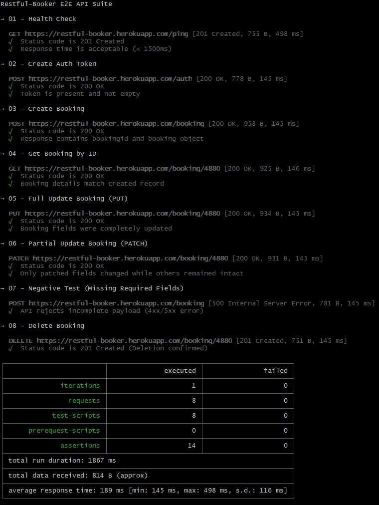

# Restful-Booker E2E API Testing Suite

Automated End-to-End (E2E) API testing suite built with **Postman** and **Postman CLI**, validating the complete booking lifecycle, authentication flow, response assertions, and negative error handling against the Restful-Booker API.

## Tech Stack & Practices
- **API Testing & CLI:** Postman (Git-linked Local Workspace / YAML Test-as-Code) & Postman CLI
- **Assertions:** JavaScript (`pm.test`, `pm.expect`)
- **QA Approach:** ISTQB Foundation Level principles (positive and negative test coverage, dynamic environment variables, request chaining, and defect documentation)

## Repository Structure
```text
restful-booker-api-qa-suite/
├── postman/
│   ├── collections/
│   │   └── Restful-Booker E2E API Suite/
│   └── environments/
│       └── Restful-Booker Prod.environment.yaml
├── reports/
│   ├── execution-evidence.png
│   └── execution-log.txt
└── README.md
```

## Covered Flow (8 Test Cases, 14 Assertions)
1. **Health Check (`GET /ping`):** Verifies service availability (`201 Created`) and response time (`< 1500ms`).
2. **Create Auth Token (`POST /auth`):** Validates authentication (`200 OK`) and stores `{{token}}`.
3. **Create Booking (`POST /booking`):** Validates booking creation (`200 OK`) and captures `{{bookingid}}`.
4. **Get Booking by ID (`GET /booking/{{bookingid}}`):** Verifies persisted data against sent payload.
5. **Full Update Booking (`PUT /booking/{{bookingid}}`):** Validates full resource update with auth token.
6. **Partial Update Booking (`PATCH /booking/{{bookingid}}`):** Validates partial field updates while preserving untouched fields.
7. **Negative Test (`POST /booking`):** Sends missing required fields and asserts that the API rejects the invalid payload (`4xx/5xx`).
8. **Delete Booking (`DELETE /booking/{{bookingid}}`):** Confirms booking deletion (`201 Created`).

## Key Finding (`BUG-001`)
- **Issue:** Sending an incomplete payload with missing required fields to `POST /booking` returns `500 Internal Server Error` instead of a client validation error (`400 Bad Request`), indicating unhandled/missing request validation on the server.

## Execution Evidence


## Execution
```bash
postman collection run "postman/collections/Restful-Booker E2E API Suite" -e "postman/environments/Restful-Booker Prod.environment.yaml"
```